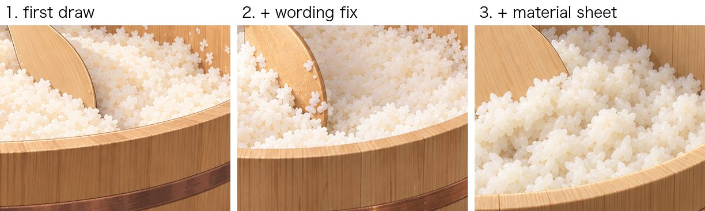
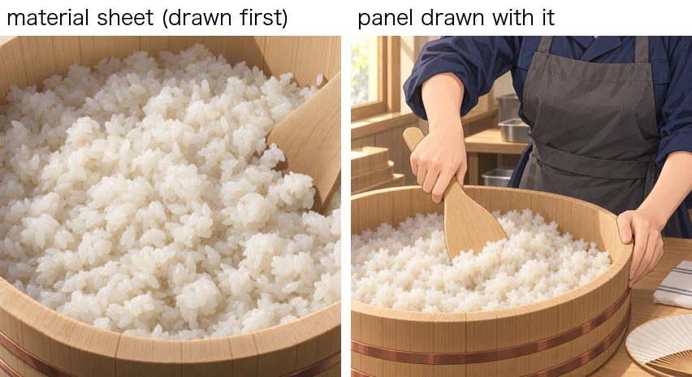
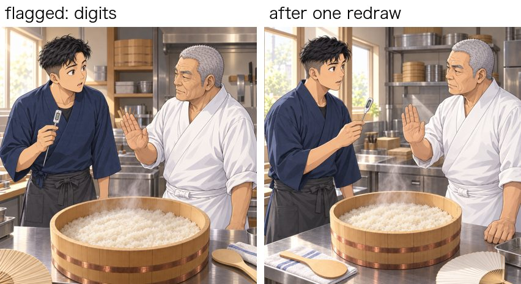
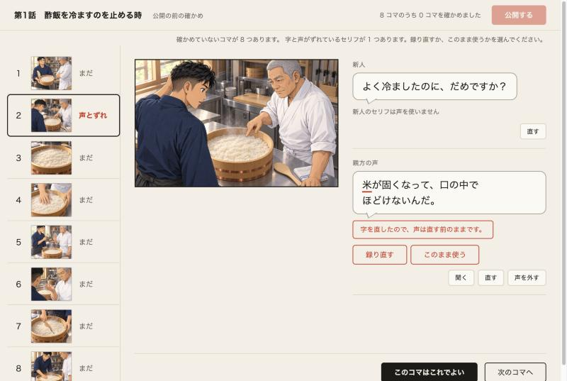
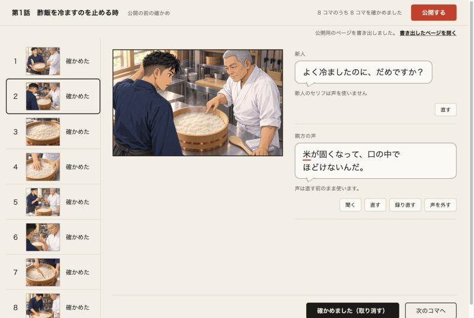

# Development log

What broke while building this, what we tried, and what finally worked. Every image here comes from the sample episode recorded during the hackathon: a fictional sushi chef, played by a team member. It is not real testimony.

## 1. Rice drawn as beads and stars → a material reference sheet

**Problem.** The craft in the sample episode is judging vinegared rice, so the rice has to look like rice. In the first full run, Claude's three-pass panel review flagged the rice in several panels: "drawn as round, pearl-like beads (tapioca-like)" and "small multi-lobed star or flower shapes … reads like popcorn or petals".

**Tried first: better wording.** We added a line to every panel prompt telling the image model to draw food true to life, with separate grains and never beads, stars or flowers. The redrawn panel still had star-shaped grains (picture 2 below).

**What worked: change the input, not the wording.** The wording fix had not touched the defect, so instead of writing more words we changed what the image model sees. The people already had reference sheets, so the material got one too:

1. The storyboard step now asks Claude to name the one material the judgment is about and describe how it really looks up close: piece size, grain, colour, surface, how the pieces sit together.
2. A close-up "material sheet" is drawn once per episode from that description.
3. Every panel that shows the material gets the sheet as an extra reference image, with an instruction to keep its shape and texture but not its framing.

**Still open.** In an extreme close-up of a hand on the rice (episode 2, panel 4) the grains are still slightly round. The review now passes it, but to our eye it is borderline.

Code: `src/lib/draw.ts` (`drawMaterial`, the material reference in `panelPrompt`), `src/lib/episode.ts` (`Material`), `src/lib/storyboard.ts` (the `material` instruction).

## 2. The review flagged almost everything → severity

**Problem.** Claude reviews every drawn panel in three passes, one question each: does the episode read as a story, do the people match their reference sheets, and are hands, gaze, objects and stray writing right. The first version marked a panel "check" for any problem it found. In the first run, 7 of 8 panels were marked. Most of the problems were real but harmless: a slightly different angle, a busy corner where a balloon was planned. A redraw list that long is useless, and redrawing costs money.

**What worked.** Every problem now carries a severity. "redraw" is only for what would mislead or put off a reader:

- a person who does not match their sheet
- malformed or extra fingers
- writing in the picture
- the two people on the wrong sides
- the panel's action not shown
- the key material reading as something else

Everything else is a "note", kept for the human but not blocking. Balloons were moved off the picture (see the reader), so empty space for balloons became a note too.

| | Panels marked | What they were |
|---|---|---|
| First run, no severity | 7 of 8 | mostly angle, framing and balloon space |
| Second run, with severity | 3 of 8 | rice in a close-up, digits on a thermometer, a paddle that read as a board. We checked all three by eye, and all three were real. |
| After one redraw of those 3 | 0 of the 3 | |

**Still open.** The review is not fully repeatable. Re-running it on unchanged panels can raise a new valid note, or occasionally a new redraw. We treat the review as a strong first reader, not a final gate.

Code: `src/lib/review.ts` (`SEVERITY`, the three passes), `src/cli.ts` (`review` prints the redraw command).

## 3. 米 heard as 目 → the craftsman confirms their own words

**Problem.** Speech recognition runs locally (whisper.cpp), then Claude proofreads the transcript for misheard craft words before anything else uses it. In the second run, the proofreading fixed four lines, for example 覚まし→冷まし, 内輪→団扇 and 足→端. It missed this one:

> 目が固くなって、口の中でほどけないんだ。 (recorded: **米**が固くなって…)

So the craftsman's balloon in panel 2 says "the *eyes* go hard" instead of "the *rice* goes hard". Raising the proofreading effort from medium to high is in the code now, but this kind of error cannot be fully caught by checking. Every balloon the craftsman speaks is checked word by word against the transcript, and that check passes, because the transcript itself is wrong.

**Fix: the craftsman confirms their own words.** Before an episode is published, the craftsman goes through it with the interviewer on the confirmation screen (`node src/cli.ts confirm --ep <id>`). Every line they speak has 聞く (play the seconds it came from), 直す, 録り直す and 声を外す, and the proofreader's corrections are listed for that panel with 合っている / 元に戻す. Publishing stays locked until every panel is passed.

Fixing 目 to 米 changes the words but not the recording, so the screen says so instead of hiding it: the panel is marked 声とずれ until the craftsman records the line again or chooses to keep the old voice.

When any wording changed, publishing translates the episode again, so the fix reaches every language:

| | Before (目) | After the craftsman's fix (米) |
|---|---|---|
| Japanese | 目が固くなって、口の中でほどけないんだ。 | 米が固くなって、口の中でほどけないんだ。 |
| Easy Japanese | ごはんの 粒(つぶ)が 固(かた)く なります。… | お米(こめ)が 固(かた)く なります。… |
| English | The grains go hard and won't fall apart in your mouth. | The rice hardens. Won't loosen in the mouth. |

The translator had already guessed "grains" from the context, while the Japanese balloon still said 目. A reader of the Japanese page would have seen the wrong word. The choices are kept in `confirm.json` next to the episode; the storyboard and the cut voices stay as they were made, so every choice can be undone.

Status: fixed (the confirmation screen is in `src/lib/confirm.ts` and `web/confirm/`).

Code so far: `src/lib/storyboard.ts` (`PROOFREAD_SYSTEM`, effort `high`), `src/lib/words.ts` (the word-by-word check).

## 4. Could the lighter steps run on Sonnet 5.5? Measured: no, they stay on Opus 5.5

**Question.** Translation and the storyboard critic look lighter than the storyboard itself, so a smaller, faster model might do. The rule we set before measuring: compare both models on the same episode, and keep Opus wherever Sonnet does worse.

**How.** `tools/compare-light-model.ts` runs both models on episode 2 with the same inputs.

- **Translation:** both models translated the same 19 balloons, plus the title and the lesson, into the four target languages. We counted what can be counted, then read every line side by side.
- **Critic:** we planted four writing problems in a copy of the storyboard and gave each model two runs. A good critic flags all four and leaves the veteran's recorded lines alone. The four planted lines were:
  - a riddle title (湯気の向こうに)
  - a slogan for the lesson (素材の声に耳を傾ける)
  - dramatic narration (運命を分ける一瞬)
  - the apprentice summing up the answer

| | Opus 5.5 | Sonnet 5.5 |
|---|---|---|
| Translation time | 51 s | 24 s |
| English balloons over 8 words (the rule is 8) | 1 of 19 | 7 of 19 |
| Read side by side | no errors found | a garbled Portuguese lesson ("encoste a palma na mão no arroz"). In easy Japanese it kept harder words (開店, しこみば) where Opus rewrote them (お店が開く前) |
| Critic: planted problems caught | 4/4, 4/4 | 4/4, 4/4 |
| Critic: false alarms | 0, 0 | 0, 1. It flagged the apprentice asking when to stop fanning as an added step, but the veteran did talk about fanning |

**Decision.** Both steps stay on Opus 5.5. Sonnet was twice as fast, but it broke the length rule and made one translation error the reader would see. Its critic false alarm would send a correct storyboard back for another (Opus) try. The model for these steps stays switchable (`CLAUDE_MODEL_LIGHT`), so the comparison can be run again when models change.

Raw results stay local (`episodes/<id>/compare/`); the script is in the repository.

## 5. The interviewer read the question out loud → the AI asked it again

**What broke.** In the first test with a real microphone, the person interviewing read the suggested opening out loud but did not press 聞いた. The next suggestion was the same opening again. It even started with "はい、よく聞こえています", an answer to the interviewer's own mic check.

**Why.** One microphone hears both people, and the transcript does not say who is speaking. The prompt only counted the questions the interviewer had marked as asked.

**Fix.** The prompt now says that the transcript mixes both voices and that talk about the equipment is setup. A question that can be heard in the transcript counts as asked, marked or not. When the veteran has not answered yet, the screen shows 返事を待ちましょう instead of a new question.

| | Before | After (same recording, replayed) |
|---|---|---|
| After the mic check only | "はい、よく聞こえています。今日は…" | the opening, without answering the mic check |
| After the opening was read out, not marked | the same opening again | wait: "冒頭の説明と録音使用の許可をたった今お願いしたところで、親方はまだ答えていません" |
